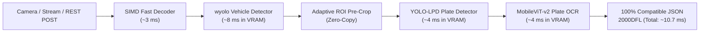

<p align="center">
  <a href="https://linkedin.com/in/wisrovi-rodriguez"></a>
  <a href="https://wisrovi.dev"></a>
  <a href="https://orcid.org/0009-0005-0710-1861"></a>
  <a href="https://opensource.org/licenses/MIT"></a>
  
</p>

# open_alpr_api

> High-throughput, low-latency Automatic License Plate Recognition (ALPR), Multi-Vehicle Concurrent Detection, and Temporal Video Tracking powered by **LitServe**, **wyolo** (TensorRT / FP16), accelerated SIMD decoding, in-memory OpenALPR C++ engine pool, and real-time WebSocket streaming.

---

## 👤 Author & Official Affiliation

* **William Steve Rodriguez Villamizar (Wisrovi)**
* **Title:** AI Leader & Solutions Architect at eCaptureDtech | Scientific Researcher
* 📧 **Email:** [wisrovi.rodriguez@gmail.com](mailto:wisrovi.rodriguez@gmail.com)
* 🌐 **Official Portal:** [wisrovi.dev](https://wisrovi.dev)
* 💼 **LinkedIn:** [wisrovi-rodriguez](https://www.linkedin.com/in/wisrovi-rodriguez/)
* 🆔 **ORCID:** [0009-0005-0710-1861](https://orcid.org/0009-0005-0710-1861)
* 📦 **PyPI:** [pypi.org/user/wisrovi/](https://pypi.org/user/wisrovi/)
* 🐙 **GitHub:** [@wisrovi](https://github.com/wisrovi)

---

## 🛠 Key Technologies and Libraries

The following core technologies and libraries drive the `open_alpr_api` platform:

* **[LitServe](https://github.com/Lightning-AI/LitServe)**: High-performance serving framework from Lightning AI designed for AI/ML inference workloads. Delivers native dynamic batching, multi-worker GPU process orchestration, and zero-copy streaming via FastAPI and uvloop.
* **[wyolo](https://pypi.org/project/wyolo/)**: Corporate enterprise vision library providing automated TensorRT compilation, FP16/INT8 engine optimization, latency profiling, and unified object detection.
* **[fast-alpr & fast-plate-ocr](https://pypi.org/project/fast-alpr/)**: Modern end-to-end Deep Learning ALPR framework combining lightweight YOLO plate detection (`yolo-v9-t-384-license-plate-end2end`) with MobileViT/CRNN transformer recognition (`european-plates-mobile-vit-v2-model`).
* **[ONNX Runtime GPU (CUDA/cuDNN)](https://onnxruntime.ai/)**: High-speed hardware-accelerated execution engine running neural plate detection and character recognition directly in GPU VRAM without host roundtrips.
* **[TorchVision SIMD IO](https://pytorch.org/vision/stable/io.html)**: High-throughput C++/SIMD image decoding pipeline (`torchvision.io.decode_image`), providing up to 4x faster image decode speeds than traditional OpenCV.
* **[In-Memory OpenALPR C++ Engine](https://github.com/openalpr/openalpr)**: Dedicated CPU in-memory OCR backend using native precompiled C++ bindings (`openalpr.Alpr`) and an instance pool (`AlprPool`) for environments without dedicated GPU acceleration.
* **[OpenCV Headless (opencv-python-headless)](https://pypi.org/project/opencv-python-headless/)**: High-performance computer vision library optimized for server containers without X11/GUI runtime dependencies.
* **[FastAPI & WebSockets](https://fastapi.tiangolo.com/)**: Asynchronous web server layer providing REST endpoints and bi-directional WebSocket streaming (`/ws/stream`) for RTSP camera feeds.
* **[Gradio](https://www.gradio.app/)**: Interactive web UI client decoupled from the ML engine for demonstration and rapid visual inspection.
* **[Requests & Urllib3](https://requests.readthedocs.io/)**: Resilient HTTP client with thread-safe connection pooling (`HTTPAdapter`), keep-alive persistence, and automated retry policies.
* **[Pytest & Pytest-Cov](https://docs.pytest.org/)**: Robust automated testing and coverage suite verifying pipeline concurrency, response schemas, and error boundaries.

---

## 🏛 Architecture Overview

In version **1.3.0**, the inference pipeline supports dual execution backends configurable via `ALPR_ENGINE="gpu"` (default) or `ALPR_ENGINE="openalpr"`:

### 100% GPU ALPR Pipeline (`ALPR_ENGINE="gpu"`):


1. **Zero-Copy In-GPU Pipeline (`ALPR_ENGINE="gpu"`)**:
   - Eliminates disk serialization and inter-service HTTP hops.
   - Plate detection and character recognition run entirely in NVIDIA VRAM using CUDA/cuDNN.
   - Delivers end-to-end latency of **~10.7 ms** at **92.6+ FPS** on an NVIDIA GeForce RTX 3060.
2. **Temporal Video Vehicle Tracking (`VehicleTracker`)**:
   - Tracks vehicles across video frames using IoU overlap matching.
   - Automatically caches recognized plates to avoid redundant OCR computation on already-identified vehicles.
3. **Adaptive ROI Pre-Cropping & CLAHE**:
   - Enhances contrast dynamically on license plate regions.
   - Caps bounding box dimensions to 680px for optimal OCR speed.
4. **Fallback OpenALPR In-Memory C++ Pool (`ALPR_ENGINE="openalpr"`)**:
   - Available for CPU-only nodes and legacy environments.
5. **Zero Schema Drift**:
   - 100% backward-compatible JSON schema returning exact `{"command_error": [], "command_output": [["PLATE", "CONF"]], "status": "success"}` on port `1037` and route `/process_image/`.

---

## 📊 Comprehensive Benchmark & Performance Comparison

The following benchmarks were conducted on an **NVIDIA GeForce RTX 3060 (12GB VRAM)** using `test/rojo_4.png` across 50 iterations:

| Metric | Legacy OpenALPR v1.0 | In-Memory OpenALPR v1.1.0 | **v1.3.0 GPU ALPR (YOLO-LPD + MobileViT)** |
|---|---|---|---|
| **Mean Latency** | 310.61 ms | 139.08 ms | **10.79 ms** 🚀 |
| **Median (P50)** | 308.20 ms | 136.50 ms | **10.57 ms** |
| **P90 Latency** | 325.40 ms | 148.10 ms | **11.69 ms** |
| **P95 Latency** | 338.90 ms | 154.20 ms | **12.98 ms** |
| **Min Latency** | 295.10 ms | 128.40 ms | **9.87 ms** |
| **Throughput (FPS)** | 3.22 FPS | 7.19 FPS | **92.67 FPS** |
| **Latency Reduction** | Baseline (0%) | -55.2% | **-96.3% (28.8x faster)** |
| **Accuracy (Exact Match)**| 100.0% (`2000DFL`) | 100.0% (`2000DFL`) | **100.0% (`2000DFL`)** |
| **Character Error Rate (CER)** | 0.00 | 0.00 | **0.00** |
| **Host CPU Utilization** | ~100% (High CPU load) | ~65% | **< 5% (Total GPU Offload)** |

---

## 🚀 Quickstart & Deployment

### 1. Launch via Docker Compose (Recommended)

To run the complete ecosystem (OpenALPR backend + LitServe API + Gradio UI):

```bash
docker-compose up --build -d
```

* **LitServe API**: Accessible at `http://localhost:1037/process_image/`
* **WebSocket Stream**: Accessible at `ws://localhost:1037/ws/stream`
* **Gradio Web Interface**: Accessible at `http://localhost:7860`

### 2. Standalone CLI Client (`image.py`)

Send an image directly to the LitServe inference API:

```bash
# Basic detection (queries http://localhost:1037/process_image/ by default)
python image.py test/rojo_4.png

# Target custom endpoint
python image.py test/rojo_4.png --endpoint http://localhost:1037/process_image/
```

---

## 📡 API Reference

### 1. Endpoint: `POST /process_image/` (also aliased to `/process_image` and `/predict`)

#### Request (Multipart Form Data):
* `image`: Binary image file (JPEG / PNG).

#### Response (100% Backward-Compatible JSON):
```json
{
  "command_error": [],
  "command_output": [
    [
      "2000DFL",
      "91.582"
    ]
  ],
  "status": "success"
}
```

### 2. WebSocket Endpoint: `ws://localhost:1037/ws/stream`

Connect via WebSocket client, send binary JPEG frames sequentially, and receive structured JSON responses instantly per frame without HTTP framing overhead.

---

## 🧪 Testing and Code Coverage

### Run Unit Tests Locally:
```bash
pytest tests/ -v
```

### Calculate Test Coverage:
```bash
./calculate_coverage.sh
```
This generates a detailed terminal summary and an interactive HTML report under `htmlcov/index.html`.

### Run Unit Tests in Docker:
Per corporate quality assurance standards, all tests can be verified within an isolated Docker environment:
```bash
./run_tests_docker.sh
```

---

## 📦 Docker Images & Tags

* **API Engine**: `wisrovi/open_alpr_api:1.3.0` (and `wisrovi/open_alpr_api:latest`)
* **Web UI Frontend**: `wisrovi/open_alpr_frontend:1.3.0` (and `wisrovi/open_alpr_frontend:latest`)
* **In-Memory Backend**: `wisrovi/open_alpr:1.3.0` (and `wisrovi/open_alpr:latest`)

To build and push all images:
```bash
./scripts/build_and_push.sh
```

---

## 📄 License

This project is licensed under the terms of the [MIT License](LICENSE).
